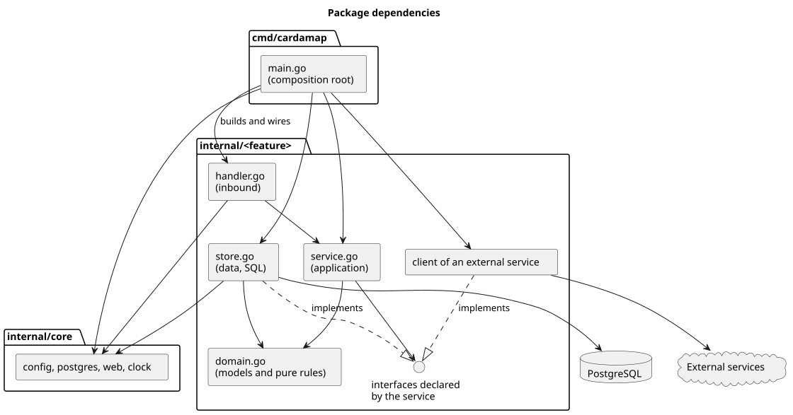

# ソースコード全体構成

> 参考の草案である。Claude が issue の数行から推測で書いたもので、決定ではない。正の文書は [ソースコード全体構成](overview.md) である。正の文書を書き終えたら、このファイルは消す。

cardamap のコードの地図である。機能ごとの設計文書の全体像は、このページを指す。

コードはまだない。このページは、最初のコードを書く前に決めた構成の方針と、予定しているパッケージを書く。パッケージを足したら、表をその時点の実際に合わせて書き換える。

## 構成の方針

図の元ファイル: [overview-ref.puml](overview-ref.puml)

クリーンアーキテクチャを参考にするが、層は増やさない。機能ごとに1つのパッケージを作り、その中でファイルを役割で分ける。

| 役割 | ファイル | 中身 | 依存してよいもの |
|---|---|---|---|
| ドメイン | `domain.go` | 型と、入出力を持たない規則。例: 識別子の正規化、採否の状態の移り変わり | 標準ライブラリだけ |
| アプリケーション | `service.go` (`Service`) | 1つの操作の手順、トランザクションの境界 | ドメイン、このファイルで宣言したインターフェース |
| データ | `store.go` (`Store`) | SQL。行とドメインの型の変換 | ドメイン、`internal/core/postgres`、pgx |
| 入口 | `handler.go` (`Handler`) | HTTP の要求を読み、`Service` を呼び、HTML を返す | アプリケーション、`internal/core/web` |

依存の向きは、入口 → アプリケーション → ドメイン、データ → ドメインである。ドメインは、HTTP、SQL、外部のサービスの型を知らない。

### 依存の渡し方

- 依存は、コンストラクター (`NewService(store, clock, ...)`) の引数で渡す。組み立ては `cmd/cardamap/main.go` だけで行う。パッケージの変数や `init` で依存を持たない
- インターフェースは、使う側のパッケージが、使うメソッドだけを宣言する。`Service` は、自分が呼ぶ保存の操作と、外部のサービス (収集元、LLM) と、時計を、インターフェースとして受け取る
- 時刻は `time.Now` を直接呼ばず、渡された時計から読む。間隔や再試行のテストで、時刻を進められるようにするためである

### テストの仕方

| 対象 | テスト | 使うもの |
|---|---|---|
| ドメイン | 表形式の単体テスト | 何も要らない |
| アプリケーション | 単体テスト。インターフェースに、テスト用の実装 (メモリーに持つ保存、決まった応答を返す収集元、進められる時計) を渡す | 何も要らない |
| データ | 実際の PostgreSQL に対する結合テスト。SQL、制約、全文検索、待ち行列の取り方を確かめる | PostgreSQL のコンテナ |
| 外部のサービスとのやりとり | 記録しておいた応答を `net/http/httptest` のサーバーから返して、読み取りを確かめる | 何も要らない |
| 入口 | `net/http/httptest` で要求を送り、状態と HTML を確かめる | 何も要らない |

`go test ./...` は、PostgreSQL がなくても通る。データの結合テストは、接続先が環境変数で渡されたときだけ動き、CI では必ず動かす。

## パッケージ

予定である。「設計」は、設計文書を書いたらリンクにする。

| パッケージ | 役割 | 設計 |
|---|---|---|
| `cmd/cardamap` | 設定を読み、データベースの接続、各機能の `Store`、`Service`、`Handler`、収集のワーカーを組み立てて、`SIGTERM` か `SIGINT` まで動かす | なし |
| `internal/core/config` | 設定ファイル (TOML) と環境変数を読み、確かめた値にする | なし |
| `internal/core/postgres` | 接続プール、トランザクションの補助、待ち行列の表の取り方 (`FOR UPDATE SKIP LOCKED`) | なし |
| `internal/core/web` | HTTP サーバー、テンプレートの読み込み、`/livez` と `/readyz`、記録 | なし |
| `internal/core/clock` | 時計のインターフェースと、実際の時計、テスト用の時計 | なし |
| `internal/source` | 収集元の設定、収集の予定と実行、資料の保存。arXiv とのやりとりは、この機能だけが使うので、このパッケージの中に置く | なし |
| `internal/screen` | 主題の定義、ふるい分けの実行、主題と評価の保存。LLM は、このパッケージが宣言するインターフェースを通して呼ぶ | なし |
| `internal/curate` | 候補の採否、主題、要約 (カテゴリ `CURATE` の案) | なし |
| `internal/browse` | 採用した資料の一覧、検索、主題のページ (カテゴリ `BROWSE` の案) | なし |
| `internal/platform/` | 複数の機能が使う、特定のサービスとのやりとり。例: Claude API (ふるい分けと、v0.3 の要約の下書きが使う)。1つの機能だけが使ううちは、その機能のパッケージに置く | なし |
