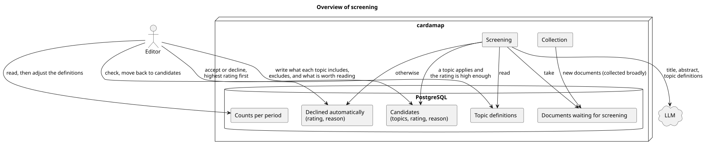

# ふるい分け

収集した資料のうち、どれを候補として編集者に見せ、どれを自動で見送るかを決める。編集者が1人で採否を決め続けられる件数まで、読む価値のある資料に絞るためのカテゴリである。

## 全体像

図の元ファイル: [overview.puml](overview.puml)

絞り込みは、2段である。

1. 収集は、カテゴリと語で広めに取る ([収集](../source/index.md))。語の一致では読む価値を判断できないので、ここでは取りこぼさないことを優先する
2. ふるい分けは、資料の題と要旨を、編集者が書いた主題の定義に照らして LLM に読ませ、主題と評価を付ける。どの主題にも当てはまらない資料と、評価が低い資料は、自動で見送る

編集者が見るのは、ふるい分けを通った候補だけである。自動で見送った資料も残し、編集者があとから確かめて候補に戻せる。ふるい分けの基準を変えたいときは、編集者が主題の定義を書き換える。

## 要件

### 基準

#### `CDM-SCREEN-001` 主題の定義を編集者が書く

編集者は、主題ごとに主題の定義を書く。主題の定義には、その主題に含めるもの、含めないもの、読む価値があるとみなす条件を、文章で書く。ふるい分けは、その時点の主題の定義を基準にする。

- 検証: `test` 主題の定義を書き換えたあとのふるい分けが、新しい定義を使う

---

### 主題と評価

#### `CDM-SCREEN-002` 主題と評価を付ける

ふるい分けは、新しく保存した資料ごとに、当てはまる主題 (0個以上) と、評価を付ける。評価は、読む価値の段階と、その理由の1文からなる。読むのは、資料の題と要旨である。

- 検証: `test` ふるい分けのあと、資料に主題、評価の段階、理由がある

---

#### `CDM-SCREEN-003` 候補にするか、自動で見送る

ふるい分けは、主題が1つ以上当てはまり、評価が決めた段階以上の資料を、候補にする。それ以外の資料は、自動で見送る。境目の段階は、設定で決める。

- 検証: `test` どの主題にも当てはまらない資料が、候補にならず、自動で見送られる
- 検証: `test` 評価が境目の段階より低い資料が、候補にならず、自動で見送られる

---

#### `CDM-SCREEN-004` 評価の高い順に見せる

候補の一覧は、評価の段階が高いものから並ぶ。候補ごとに、主題と、評価の理由を読める。

- 検証: `demo` 候補の一覧が評価の高い順に並び、主題と理由が出ている

---

### 確かめる

#### `CDM-SCREEN-005` 自動で見送った資料を確かめて戻せる

編集者は、自動で見送った資料の一覧を、評価の理由と一緒に読める。その中の資料を、候補に戻せる。

- 検証: `demo` 自動で見送った資料を一覧で読み、1件を候補に戻すと、候補の一覧に出る

---

#### `CDM-SCREEN-006` ふるい分けの確かさを数で読める

編集者は、期間ごとに、収集した件数、候補にした件数、自動で見送った件数、候補のうち採用した件数と見送った件数、自動の見送りから候補に戻した件数を読める。主題の定義と境目の段階を直す手がかりにするためである。

- 検証: `demo` 画面で、期間ごとの件数を読める

---

### 止まらない

#### `CDM-SCREEN-007` LLM が使えなくても資料を失わない

LLM が使えないあいだ、収集は続け、資料はふるい分けを待つ。LLM が使えるようになったら、待っていた資料をふるい分ける。待っているあいだ、資料は候補にも自動の見送りにもならない。

- 検証: `test` LLM が失敗を返すあいだに収集した資料が、ふるい分けを待つ状態で残り、LLM が戻ったあとにふるい分けられる

---

## 未決事項

- 評価の段階の数と、境目の初めの値
- 主題の定義を、設定ファイルに書くか、画面から書くか。主題そのものの持ち方 (カテゴリ `CURATE` の案) と一緒に決める
- 主題の定義を書き換えたとき、すでに自動で見送った資料をふるい分け直すか
- 1日の候補の件数に上限を設けるか。設けるなら、超えた分をどう扱うか
- ふるい分けに使うモデルと、1か月の費用の上限。1日に収集する件数を測ってから決める
- 最初の主題と主題の定義。編集者が書く。例えば、End-to-End 運転、世界モデル、安全論証と検証、最小リスク操作、ロボットの基盤モデル
