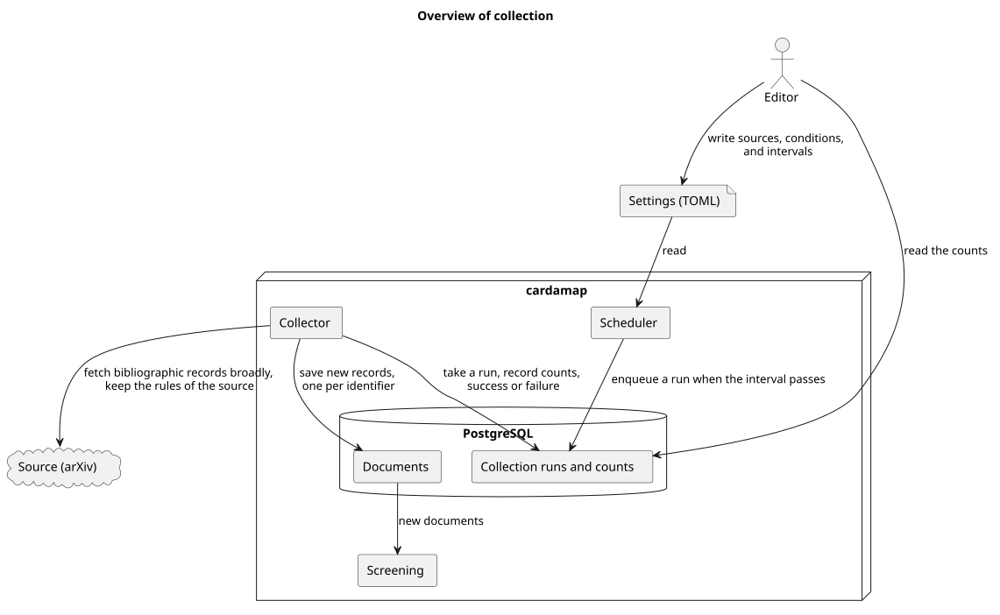

# 収集

収集元から資料の書誌情報をどう集め、何を保存するかを決める。v0.1 の収集元は arXiv だけで、資料の種類は論文だけである。

## 全体像

図の元ファイル: [overview.puml](overview.puml)

編集者は、収集元を設定に書く。cardamap は、収集元ごとに決めた間隔で書誌情報を取ってきて、まだ持っていない資料を保存する。

収集は、取りこぼさないように広めに取る。収集元の検索は、カテゴリと語の一致しか見られず、読む価値は判断できないためである。絞るのは、次の [ふるい分け](../screen/index.md) である。

## arXiv について確かめたこと

2026-11-17 に、arXiv の公式の文書で確かめた。

| 確かめたこと | 文書 |
|---|---|
| arXiv API の検索は、カテゴリ (`cat`)、題 (`ti`)、要旨 (`abs`) などの欄を指定でき、`AND`、`OR`、`ANDNOT`、括弧、引用符で囲んだ句を組み合わせられる | [arXiv API User's Manual](https://info.arxiv.org/help/api/user-manual.html) |
| 投稿日の範囲 (`submittedDate`) で絞れる。投稿日か更新日の順に並べられる | 同上 |
| 1回の要求で取れるのは 2000 件まで、1つの検索で取れるのは 30000 件までである | 同上 |
| 要求は3秒に1回までで、同時の接続は1つまでである。arXiv API、OAI-PMH、RSS のどれにも当てはまる | [Terms of Use for arXiv APIs](https://info.arxiv.org/help/api/tou.html) |
| 題、要旨、著者、識別子、カテゴリといった書誌情報は CC0 で、取ってきて保存し、加工して使える。PDF と本文は、この許しに含まれない | 同上 |
| arXiv のデータを使う製品には、決められた謝辞の文を載せるよう求められている | 同上 |
| カテゴリの新着は、RSS (複数のカテゴリをまとめて取れる) と OAI-PMH (カテゴリごとに、日付からの差分を取れる) でも取れる | [RSS](https://info.arxiv.org/help/rss.html)、[OAI-PMH](https://info.arxiv.org/help/oa/index.html) |

## 要件

### 収集元

#### `CDM-SOURCE-001` 収集元を設定で決める

編集者は、収集元を設定ファイルに書いて決める。収集元ごとに、取る条件と、収集の間隔を書ける。arXiv の取る条件は、カテゴリと、題と要旨の語の組み合わせである。画面からは変えない。

- 検証: `test` 設定に書いた収集元だけが収集され、設定から消した収集元は収集されなくなる

---

#### `CDM-SOURCE-004` 収集元の利用の決まりを守る

収集は、収集元が公開している利用の決まりを守る。例えば、要求と要求のあいだを決められた時間だけ空け、同時の接続の数を守る。収集元が謝辞を求めるときは、画面に載せる。

- 検証: `test` 同じ収集元への続けての要求が、決めた間隔より短くならず、同時に2つ以上つながらない
- 検証: `inspection` 設計文書に、収集元ごとの利用の決まりと、確かめた公式の文書が書いてある
- 検証: `demo` 画面に、収集元が求める謝辞がある

---

### 収集

#### `CDM-SOURCE-002` 決めた間隔で収集する

cardamap は、収集元ごとに、設定に書いた間隔で収集する。編集者が何も操作しなくても動く。再起動のあとは、前の収集からの間隔を引き継ぐ。

- 検証: `test` 間隔が過ぎた収集元だけが収集される。再起動の直後に、間隔が過ぎていない収集元は収集されない

---

#### `CDM-SOURCE-003` 同じ資料を二重に保存しない

識別子が同じ資料は、1件として保存する。別の収集元や別の回の収集で同じ資料が届いても、資料は増えない。すでに持っている資料は、再びふるい分けに回さない。

- 検証: `test` 同じ識別子の書誌情報を2回収集しても、資料は1件である
- 検証: `test` 見送った資料と同じ識別子の書誌情報を収集しても、ふるい分けに回らない

---

#### `CDM-SOURCE-005` 失敗しても続ける

1つの収集元の収集が失敗しても、ほかの収集元の収集は続ける。失敗した収集は、次の間隔でやり直す。失敗した時刻と理由を記録する。

- 検証: `test` 1つの収集元が応答しないとき、ほかの収集元の資料が保存され、失敗が記録される

---

#### `CDM-SOURCE-007` 収集した件数を記録する

収集のたびに、収集元ごとに、届いた件数と、新しく保存した件数を記録する。編集者は、この記録を画面で読める。取る条件が広すぎるか狭すぎるかを、編集者が判断するためである。

- 検証: `test` 収集のあと、その回の届いた件数と新しく保存した件数が記録されている
- 検証: `demo` 画面で、収集元ごとの日ごとの件数を読める

---

### 保存するもの

#### `CDM-SOURCE-006` 書誌情報だけを保存する

収集で保存するのは、書誌情報だけである。資料の本文と PDF は保存しない。どの収集元からいつ収集したかも、資料ごとに保存する。

- 検証: `test` 収集した資料に、題、著者、公開日、識別子、出典へのリンク、要旨、収集元、収集した時刻がある

---

## 未決事項

- arXiv の取る条件の初めの値。どのカテゴリを取るか、語でも絞るか。1日に届く件数を実際に測って決める
- 毎日の差分の取り方。arXiv API の投稿日の範囲で取るか、RSS か OAI-PMH でカテゴリの新着を丸ごと取るか。設計文書で決める
- 収集元が資料を改訂したとき (例: 論文の新しい版) に、書誌情報を更新するか、編集者に知らせるか
- 最初の収集で、どこまで過去にさかのぼるか
