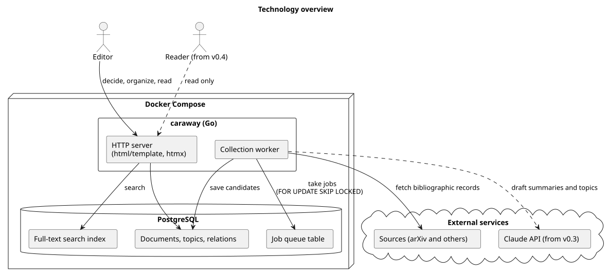

# 技術要素

caraway で使う技術と、それを選んだ理由を書く。具体的な設計は、設計文書に書く。

## 構成

図の元ファイル: [technology.puml](technology.puml)

- caraway は、1つの Go のサービスと1つの PostgreSQL からなる。サービスは、画面を出すことと、収集を定期的に動かすことの両方をする
- 外へ出す接続は、収集元と LLM への外向きの接続だけである
- v0.3 までは家のサーバーで動かし、編集者だけが使う。公開の仕方は v0.4 で決める
- Go で書くと大きく不利になる処理が出てきたときだけ、その処理を Python のワーカーに切り出す。今はない

## 使う技術

| 要素 | 技術 | 選んだ理由 |
|---|---|---|
| サービス | Go (標準ライブラリを優先。`net/http` の `ServeMux`、`log/slog`、`encoding/json`、`encoding/xml`、`context`) | 常駐する小さなサービスに向く。1つのバイナリで配置できる。収集元の応答 (Atom、RSS、JSON) は標準ライブラリで読める |
| 画面 | Go の `html/template` と htmx | 一覧、検索、採否の操作は、サーバーで作った HTML で足りる。JavaScript のビルドを持たずに済む |
| 見た目 | Tailwind CSS | クラスを書くだけで見た目を整えられる |
| データベース | PostgreSQL | 資料、主題、関係を表として持ち、結合と再帰の問い合わせ (`WITH RECURSIVE`) で主題の親子と関係をたどれる。公開したあとも同じものを使える |
| データベースへの接続 | pgx | PostgreSQL の型と機能 (配列、JSONB、`LISTEN`/`NOTIFY`) をそのまま使える |
| 検索 | PostgreSQL の全文検索 (`tsvector`、GIN インデックス) | 論文の題と要旨は英語が多く、PostgreSQL に元からある全文検索で引ける。検索のためのサービスを別に動かさずに済む |
| 収集の予定と実行 | PostgreSQL の表を待ち行列にする (`FOR UPDATE SKIP LOCKED`) | 収集の予定、実行、失敗、再試行を、資料と同じデータベースに同じトランザクションで記録できる。待ち行列のためのサービスを別に動かさずに済む |
| スキーマの管理 | Atlas (宣言したスキーマを正とし、版ごとの SQL を生成する) | あるべきスキーマを1か所で読める。生成した SQL を確かめてから適用できる |
| 設定 | TOML ファイル | 収集元と間隔は、ファイルを書き換えれば足りる。秘密の値は入れない |
| 要約と主題の下書き (v0.3) | Claude API を Go から呼ぶ | Go から呼べるので、Python を足さずに済む |
| 動かし方 | Docker Compose | サービスと PostgreSQL を1つの Compose プロジェクトにまとめられる。同じイメージが、家のサーバーでも、あとで選ぶ公開の場所でも動く |
| 配布 | GitHub Container Registry (GHCR) | イメージは CI で作って GHCR に置き、動かす場所ではビルドしない |
| 記録と監視 | `log/slog` で JSON の行を標準出力に書く。`/livez` と `/readyz` を出す | 動かす場所を問わず、同じ方法で記録を集め、生きているかを確かめられる |
| 図 | PlantUML | 図をテキストで持ち、差分を読める |

## ライブラリの方針

- Go の標準ライブラリと PostgreSQL に元からある機能を優先する。足りるうちは、ライブラリ、拡張、別のサービスを足さない
- データベースのドライバーや LLM の SDK のように、自分で作ると危ないものや大きいものは、よく保守されたライブラリを使う
- ライブラリや PostgreSQL の拡張を足すときは、理由を Pull Request に書く
- Web フレームワーク、ORM、DI のコンテナは使わない。依存は、`cmd/` でコンストラクターに渡して組み立てる
- 外部のサービスの型は、そのサービスとやりとりするパッケージの中で止め、資料と主題の規則には持ち込まない

## 決めていないこと

| 決めること | 選択肢と今の見立て | 決めるとき |
|---|---|---|
| 日本語の検索 | PostgreSQL に元からある全文検索の設定に、日本語を語に分けるものはない。要約と解説を日本語で検索するには、付属の拡張 `pg_trgm` か、別の拡張 (PGroonga など) が要る見込みである。まず `pg_trgm` で足りるかを確かめる | v0.1 の検索を設計するとき |
| arXiv からの取り方 | arXiv API、OAI-PMH、RSS がある。それぞれの利用の決まり (要求の間隔、書誌情報の利用条件) を公式の文書で確かめてから選ぶ | v0.1 の収集を設計するとき |
| 論文の引用関係の取り方 (v0.2) | OpenAlex や Semantic Scholar の API がある。利用の決まりを公式の文書で確かめてから選ぶ | v0.2 の関係を設計するとき |
| 意味での検索 | 埋め込みと PostgreSQL の拡張 pgvector を使う方法がある。全文検索で足りないと分かるまで足さない | 全文検索で引けない資料が目立ってきたとき |
| Python のワーカー | PDF の本文の解析のように、Go のライブラリが弱い処理が要るときだけ足す。足すときは、PostgreSQL の待ち行列を通して Go のサービスとやりとりする | そのような処理を要件に入れるとき |
| 公開の仕方 (v0.4) | 家のサーバーを外向きのトンネルで出す、VPS に置く、静的なファイルに書き出して配る、がある。編集者の画面は、どの場合も公開しない | v0.4 を始めるとき |
| 編集者の認証 | v0.3 までは、家のネットワークの中からだけ届くことを認証の代わりにする。公開の仕方によっては、編集者の画面に認証が要る | 公開の仕方を決めるとき |
| ローカル開発のポート | 開発機でほかのプロダクトと重ならないポートを割り当てる | 最初のコードを書くとき |
